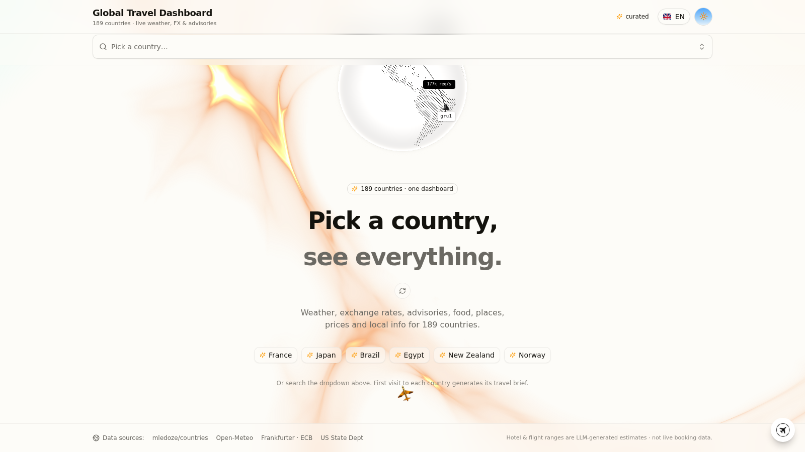
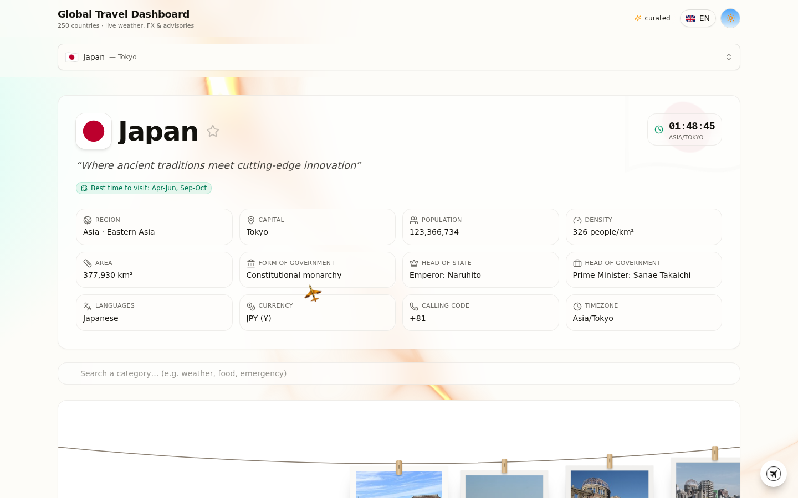
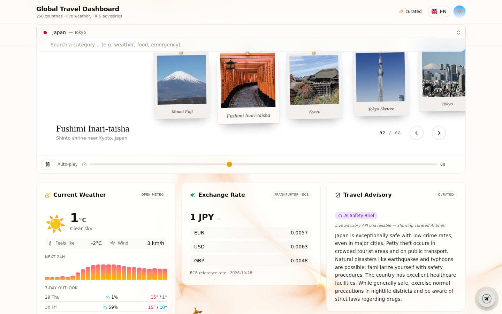
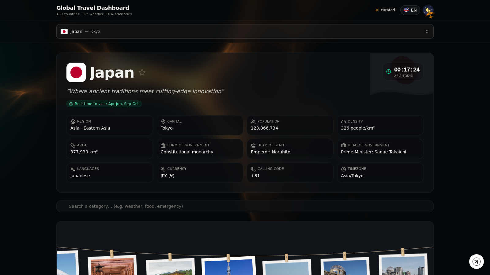

# Global Travel Dashboard

A travel dashboard for 250 countries. Live weather, exchange rates, travel advisories, earthquakes and economic data on one page, next to a short AI-written brief — overview, culture, food, places, prices — generated the first time you open a country and stored in the database after that.

**[Live demo](https://global-travel-dashboard.vercel.app)** · [MIT license](LICENSE)



## What it does

- Pick a country by search, or spin the 3D globe
- Live data for the selection: weather with 7-day forecast (Open-Meteo), ECB exchange rates (Frankfurter), US State Department advisory levels, recent earthquakes (USGS), World Bank GDP figures, Wikipedia photos, local clock
- An LLM writes the slow-moving parts — country overview, culture, unwritten rules, safety notes, typical food, places worth visiting, hotel and flight price estimates. Written once, persisted afterwards, so it loads instantly on every later visit
- UI in English, Spanish, Italian and French; other locales can be translated on the fly by the same LLM and cached
- Light and dark theme, responsive layout, voice input for the AI chat

## Data sources

| Category | Source | Updated |
|---|---|---|
| Weather + 7-day forecast | Open-Meteo (fallback wttr.in) | Real-time |
| Exchange rates | Frankfurter / ECB | Daily |
| Travel advisories (levels 1–4) | US State Dept | Daily |
| GDP, GDP per capita | World Bank | Annual |
| Earthquakes | USGS | Real-time |
| Photos | Wikipedia | Stable |
| Local time | IANA tz database | Real-time |
| Briefs, food, places, prices | LLM, generated once and persisted | First visit |

## Screenshots







## Running locally

```bash
git clone https://github.com/pirrox809-del/global-travel-dashboard.git
cd global-travel-dashboard
bun install            # or npm install
cp .env.example .env
bun run db:generate    # the SQLite DB is pre-populated, no seed needed
bun run dev            # http://localhost:3000
```

Next.js 16 (App Router), TypeScript 5, Tailwind CSS 4, shadcn/ui, Prisma + SQLite, Framer Motion, react-globe.gl/cobe.

## Deploying

Vercel works without configuration: import the repository and deploy. The pre-populated SQLite database ships inside the serverless function and is copied to a writable path at runtime, so the API answers from the first request.

Two things worth knowing:

- Travel AI needs LLM credentials: either a `.z-ai-config` file or `ZAI_BASE_URL` + `ZAI_API_KEY` environment variables (plus `ZAI_MODEL` when the provider requires a model name). Any OpenAI-compatible endpoint works. Without credentials nothing breaks — live data and pre-generated briefs keep working, the chatbot just says it is not enabled.
- On serverless, writes are per-instance and ephemeral. If you want generated briefs to survive restarts, host on Railway or Render with a persistent disk and set `DATABASE_URL=file:/data/custom.db`.

## Automatic data updates

Freshness is handled on two levels, with no manual work:

1. **Live data — always fresh.** Exchange rates, weather, earthquakes, holidays, safety advisories and news are fetched from their APIs on every request (with short in-memory caching). Nothing to schedule.
2. **AI briefs — daily rotation.** A Vercel Cron job (see `vercel.json`, daily at 03:00 UTC) calls `/api/cron/refresh`, which regenerates the 2 oldest country briefs into a disposable DB copy and reports coverage. Set these optional env vars to complete the loop:
   - `CRON_SECRET` — secures the endpoint (Vercel sends it automatically).
   - `GH_TOKEN` + `GH_REPO` (+ `GH_BRANCH`, default `main`) — with a fine-grained GitHub token ("Contents: read/write"), the refreshed database is committed back to the repository, which triggers a redeploy so the new briefs go live on their own.
   - `REFRESH_KEY` — optionally trigger a manual run any time with `https://<your-app>/api/cron/refresh?key=<REFRESH_KEY>&batch=3`.

   With ~2 countries refreshed per day, the whole 250-country dataset rotates every ~4 months — appropriate for evergreen editorial content whose live data never ages anyway.

## Project structure

```
src/
├── app/                  # App Router: page, layout, API routes
│   └── api/countries/    # Countries aggregation endpoint
├── components/
│   ├── ui/               # shadcn/ui + custom (globe, cursor, animations)
│   └── dashboard/        # Dashboard sections (weather, economy, culture…)
├── lib/
│   ├── external/         # External API clients (World Bank, USGS, Open-Meteo…)
│   ├── cache.ts          # In-memory cache with TTL
│   ├── db.ts             # Prisma client + serverless-aware DB resolution
│   └── i18n.ts           # UI translations (EN/ES/IT/FR)
└── prisma/schema.prisma  # Data model
db/custom.db              # Pre-populated SQLite database
```

## Credits

[mledoze/countries](https://github.com/mledoze/countries) · [Open-Meteo](https://open-meteo.com) · [Frankfurter](https://frankfurter.dev) · [US State Dept](https://travel.state.gov) · [World Bank](https://data.worldbank.org) · [USGS](https://earthquake.usgs.gov) · [Wikipedia](https://wikipedia.org) · [shadcn/ui](https://ui.shadcn.com)

Each data source remains subject to its own terms of use.

## License

[MIT](LICENSE)

---

<details>
<summary><b>Documentazione in italiano</b></summary>

### Global Travel Dashboard

Dashboard di viaggio per 250 paesi: meteo live, tassi di cambio, avvisi di viaggio, terremoti e dati economici in una sola pagina, insieme a una breve guida scritta dall'AI — panoramica, cultura, cibo, luoghi, prezzi — generata al primo accesso e salvata nel database.

**[Demo live](https://global-travel-dashboard.vercel.app)** — senza registrazione né configurazione.

### Fonti dei dati

| Categoria | Fonte | Aggiornamento |
|---|---|---|
| Meteo + previsioni 7 giorni | Open-Meteo (fallback wttr.in) | Tempo reale |
| Tassi di cambio | Frankfurter / BCE | Quotidiano |
| Avvisi di viaggio (livelli 1–4) | US State Dept | Quotidiano |
| PIL, PIL pro capite | World Bank | Annuale |
| Terremoti | USGS | Tempo reale |
| Foto | Wikipedia | Stabile |
| Ora locale | IANA tz database | Tempo reale |
| Brief, cibo, luoghi, prezzi | LLM, generato una volta e persistito | Primo accesso |

### Avvio locale

```bash
git clone https://github.com/pirrox809-del/global-travel-dashboard.git
cd global-travel-dashboard
bun install            # oppure npm install
cp .env.example .env
bun run db:generate    # il DB SQLite è già pre-popolato
bun run dev            # http://localhost:3000
```

### Pubblicazione

Su Vercel funziona senza alcuna configurazione: importa la repository e fai deploy. Il database SQLite pre-popolato viene incluso nella funzione serverless e copiato in un percorso scrivibile all'avvio, quindi l'API risponde già alla prima richiesta.

Due cose da sapere:

- Travel AI ha bisogno di credenziali LLM: un file `.z-ai-config` oppure le variabili d'ambiente `ZAI_BASE_URL` + `ZAI_API_KEY` (con `ZAI_MODEL` se il provider lo richiede). Va bene qualsiasi endpoint OpenAI-compatibile. Senza credenziali nulla si rompe: i dati live e i brief pre-generati continuano a funzionare, solo la chat resta disattivata.
- Su serverless le scritture sono per-istanza ed effimere. Per conservare i brief generati, usa Railway o Render con disco persistente e `DATABASE_URL=file:/data/custom.db`.

</details>
