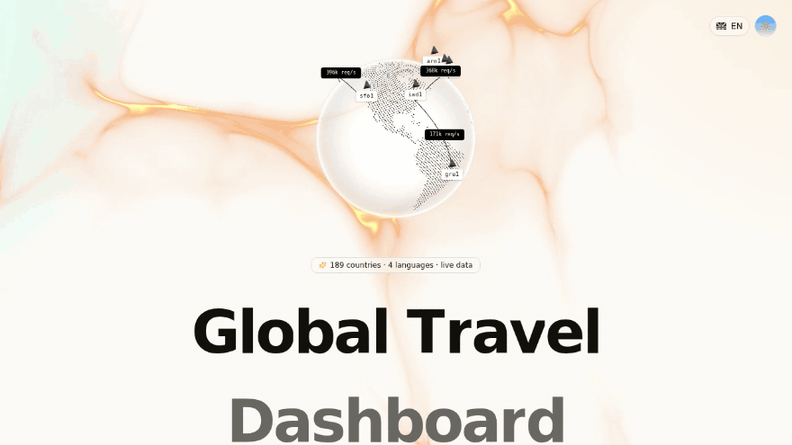

<div align="center">

# 🌍 Global Travel Dashboard

**189 countries. One view. Live weather, exchange rates, travel advisories, earthquakes — plus LLM-curated guides, food & places.**

[](https://global-travel-dashboard.vercel.app)


**[English](#-what-you-get) · [Italiano](#-documentazione-completa-in-italiano)**

<br>



</div>

## ✨ What you get

Pick any of **189 countries** and get a complete, continuously-updated travel dashboard:

- 🌐 **3D interactive globe** + instant country search
- 🌦️ **Live data** — weather with 7-day forecast, FX rates, government travel advisories, recent earthquakes, GDP, authentic photos, local clock with seconds
- 🤖 **LLM-curated travel brief** — overview, culture, unwritten rules, safety, typical food, places to visit, price estimates. Generated once on first visit, then **persisted in the database** (it's a cache layer, not a per-refresh cost)
- 🗣️ **4 UI languages** — English, Español, Italiano, Français — plus on-the-fly LLM translation for any other locale
- 🌗 Light/dark theme, fully responsive, voice input for the AI chat

### 📡 Where the data comes from

| Category | Source | Update |
|---|---|---|
| 🌦️ Live weather + 7-day forecast | Open-Meteo (fallback wttr.in) | Real-time |
| 💱 Exchange rates | Frankfurter · ECB | Daily |
| 🚨 Travel advisories (levels 1–4) | US State Dept | Daily |
| 💰 Economy (GDP, GDP per capita) | World Bank | Annual |
| 🌍 Recent earthquakes | USGS | Real-time |
| 📷 Authentic photos | Wikipedia | Stable |
| 🕐 Local time | IANA tz database | Real-time |
| 📝 Overview, culture, unwritten rules, safety | LLM — generated once, persisted | Once |
| 🍝 Food, places, price estimates | LLM + DB normalization | Once |
| 👥 Famous people, TV channels, internet quality | LLM | Once |

## 📸 Screenshots

| Dashboard | Country view |
|---|---|
|  |  |
| **Live data cards** | **Dark mode** |
|  |  |

## 🧱 Tech stack

- **Next.js 16** (App Router) + **TypeScript 5**
- **Tailwind CSS 4** + **shadcn/ui** (New York) + Lucide icons
- **Prisma ORM** + SQLite (pre-populated with 250 countries)
- **Framer Motion** (transitions, "shutter" title animation)
- **react-globe.gl / cobe** (3D globe)
- In-memory TTL cache + file-traced DB for serverless

## 🚀 Run it locally

```bash
# 1. Clone & install
git clone https://github.com/pirrox809-del/global-travel-dashboard.git
cd global-travel-dashboard
bun install        # or: npm install

# 2. Configure the environment
cp .env.example .env

# 3. Generate the Prisma client (DB is already pre-populated)
bun run db:generate

# 4. Start
bun run dev        # http://localhost:3000
```

> **LLM content**: the AI brief generator reads credentials from a `.z-ai-config`
> file (`{"baseUrl": "...", "apiKey": "..."}` — any OpenAI-compatible endpoint).
> Without credentials the app still runs: all **live-data sections work**, and the
> briefs **pre-generated in the committed DB** are served as-is.

## ☁️ Deploy to Vercel (zero config)

1. Push the repo to GitHub → [vercel.com](https://vercel.com) → **Add New → Project** → import
2. **Deploy.** That's it — no environment variables needed.

What happens under the hood:

- The pre-populated SQLite DB is **shipped inside the serverless function**
  (`outputFileTracingIncludes`) and copied to `/tmp` at runtime — Prisma finds it
  automatically, so the API works out of the box.
- All **live-data features** work immediately; pre-generated briefs are served from the DB.
- ⚠️ **LLM generation** needs the `.z-ai-config` credentials (Vercel env/secret or your own
  OpenAI-compatible endpoint). Without them the UI degrades gracefully — nothing breaks.
- Writes (e.g. newly generated briefs) are **ephemeral per lambda instance** on Vercel.
  Want persistent writes with zero code changes? Use **Railway** or **Render** with a
  persistent volume and `DATABASE_URL=file:/data/custom.db`.

## 📂 Project structure

```
src/
├── app/                  # App Router: page.tsx, layout, API routes
│   └── api/countries/    # Countries aggregation endpoint
├── components/
│   ├── ui/               # shadcn/ui + custom (globes, cursor, animations)
│   └── dashboard/        # Dashboard sections (weather, economy, culture…)
├── lib/
│   ├── external/         # External API clients (World Bank, USGS, Open-Meteo…)
│   ├── cache.ts          # In-memory cache with TTL
│   ├── db.ts             # Prisma client + serverless-aware DB resolution
│   └── i18n.ts           # Translations (EN/ES/IT/FR)
└── prisma/schema.prisma  # Data model
db/custom.db              # Pre-populated SQLite database
```

## 🙏 Acknowledgements

Data and tools: [mledoze/countries](https://github.com/mledoze/countries) · [Open-Meteo](https://open-meteo.com) · [Frankfurter · ECB](https://frankfurter.dev) · [US State Dept](https://www.travel.state.gov) · [World Bank](https://data.worldbank.org) · [USGS](https://earthquake.usgs.gov) · [Wikipedia](https://wikipedia.org) · [shadcn/ui](https://ui.shadcn.com)

## 📄 License

[MIT](LICENSE) — free to use, fork and build upon. Each data source remains subject to its own terms.

---

<div align="center">

### 🇮🇹 Documentazione completa in italiano

</div>

**Ogni paese, una pagina.** Dashboard completa per **189+ paesi** con dati ufficiali in tempo reale e contenuti di viaggio curati dall'AI.

### Cosa contiene ogni dashboard

| Categoria | Fonte | Aggiornamento |
|---|---|---|
| 🌦️ Meteo live + previsioni 7 giorni | Open-Meteo (fallback wttr.in) | Tempo reale |
| 💱 Tassi di cambio | Frankfurter · BCE | Quotidiano |
| 🚨 Avvisi di viaggio (livelli 1–4) | US State Dept | Quotidiano |
| 💰 Economia (PIL, PIL pro capite) | World Bank | Annuale (ultimo anno disponibile) |
| 🌍 Terremoti recenti | USGS | Tempo reale |
| 📷 Foto autentiche | Wikipedia | Stabile |
| 🕐 Ora locale con secondi | IANA tz database | Tempo reale |
| 📝 Panoramica, cultura, regole non scritte, sicurezza | LLM (generato al primo accesso, poi persistito) | Una tantum |
| 🍝 Cibi tipici, luoghi da visitare, stime prezzi | LLM + normalizzazione DB | Una tantum |
| 👥 Personaggi famosi, canali TV, qualità internet | LLM | Una tantum |

### Avvio locale

```bash
git clone https://github.com/pirrox809-del/global-travel-dashboard.git
cd global-travel-dashboard
bun install                # oppure: npm install
cp .env.example .env
bun run db:generate        # il DB è già pre-popolato con 250 paesi
bun run dev                # http://localhost:3000
```

> **Contenuti LLM**: il generatore legge le credenziali da un file `.z-ai-config`
> (`{"baseUrl": "...", "apiKey": "..."}` — qualsiasi endpoint OpenAI-compatibile).
> Senza credenziali l'app funziona comunque: tutte le sezioni con **dati live
> continuano a funzionare** e i brief **pre-generati nel DB** restano visibili.

### Pubblicazione online

**Vercel (consigliata — zero configurazione):** importa il repo da [vercel.com](https://vercel.com) e premi **Deploy**. Non serve alcuna variabile d'ambiente: il database SQLite viene incluso nella funzione serverless e copiato in `/tmp` automaticamente all'avvio. I dati live e i brief pre-generati funzionano subito; la generazione LLM richiede le credenziali `.z-ai-config` (senza di esse l'interfaccia degrada con eleganza, senza rompersi). Le scritture su Vercel sono efimere per istanza: per scrittura persistente usa Railway/Render con un volume e `DATABASE_URL=file:/data/custom.db`.

**Railway / Render:** host con filesystem persistente — SQLite funziona così com'è. Monta un volume su `/data` e imposta `DATABASE_URL=file:/data/custom.db`.

### Riepilogo cosa funziona dove

| Funzionalità | Vercel | Railway/Render (volume) |
|---|---|---|
| Frontend + UI + globo 3D | ✅ | ✅ |
| Meteo / cambi / advisory / terremoti / PIL / foto | ✅ | ✅ |
| Lettura contenuti dal DB pre-popolato | ✅ (auto /tmp) | ✅ |
| Generazione nuovi contenuti LLM | ⚠️ serve `.z-ai-config` | ⚠️ serve `.z-ai-config` |

### Licenza

[MIT](LICENSE) — dati forniti da API pubbliche citate sopra (ringraziamenti a Open-Meteo, Frankfurter/BCE, USGS, World Bank, US State Dept, Wikipedia, mledoze/countries).
