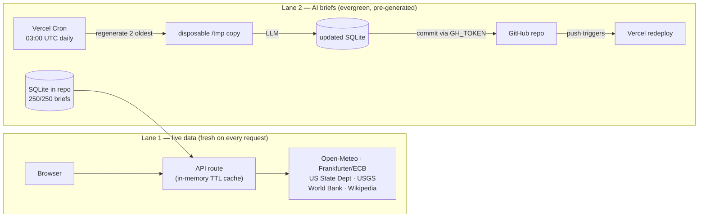
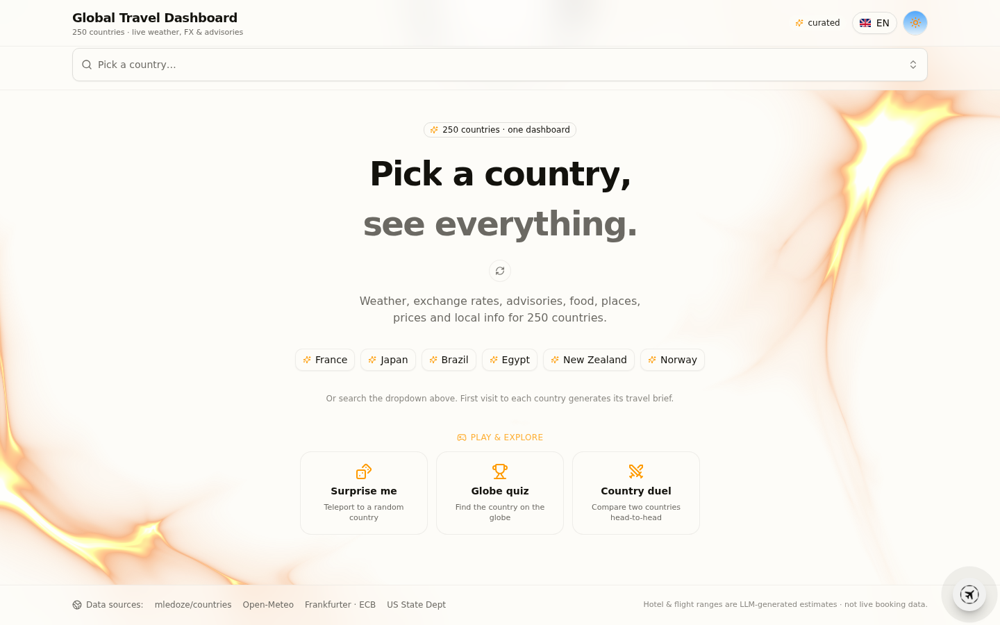

# Global Travel Dashboard

[](https://nextjs.org)
[](https://www.typescriptlang.org)
[](https://tailwindcss.com)
[](https://www.prisma.io)
[](LICENSE)
[](https://github.com/pirrox809-del/global-travel-dashboard/stargazers)

A travel dashboard for **250 countries — none excluded**. Live weather, exchange rates, travel advisories, earthquakes and economic data on one page, next to a short AI-written brief — overview, culture, food, places, prices — generated the first time you open a country and stored in the database after that.

**🌐 [Open the live demo](https://global-travel-dashboard.vercel.app)** · [MIT license](LICENSE)


## What it does

- Pick a country by search, or spin the 3D globe
- **Play & explore**: 🎲 *Surprise me* teleports you to a random country, 🏆 *Globe quiz* asks you to find countries on the globe against the clock, ⚔️ *Country duel* compares any two countries head-to-head on population, area, GDP, safety and weather
- Live data for the selection: weather with 7-day forecast (Open-Meteo), ECB exchange rates (Frankfurter), US State Department advisory levels, recent earthquakes (USGS), World Bank GDP figures, Wikipedia photos, local clock
- An LLM writes the slow-moving parts — country overview, culture, unwritten rules, safety notes, typical food, places worth visiting, hotel and flight price estimates. Written once, persisted afterwards, so it loads instantly on every later visit
- UI in English, Spanish, Italian and French; other locales can be translated on the fly by the same LLM and cached
- Light and dark theme, responsive layout, voice input for the AI chat

## How it works

Two data lanes with very different freshness requirements:



- **Live data** is fetched per-request with short in-memory caching — nothing to schedule, nothing to go stale.
- **AI briefs** are editorial content: generated once, persisted in the committed SQLite database, and rotated daily (the 2 oldest entries get refreshed). The cron commits the updated database straight back to the repository, so every push triggers a redeploy and the site heals itself.

## Data sources

| Category | Source | Updated |
|---|---|---|
| Weather + 7-day forecast | Open-Meteo (fallback wttr.in) | Real-time |
| Exchange rates | open.er-api.com (fallback Frankfurter / ECB) | Daily |
| Travel advisories (levels 1–4) | US State Dept | Daily |
| GDP, GDP per capita | World Bank | Annual |
| Earthquakes | USGS | Real-time |
| Photos | Wikipedia | Stable |
| Local time | IANA tz database | Real-time |
| Briefs, food, places, prices | LLM, generated once and persisted | First visit |

Each data source remains subject to its own terms of use.

## Screenshots





## Running locally

```bash
git clone https://github.com/pirrox809-del/global-travel-dashboard.git
cd global-travel-dashboard
bun install            # or npm install
cp .env.example .env
bun run db:generate    # the SQLite DB is pre-populated, no seed needed
bun run dev            # http://localhost:3000
```

Next.js 16 (App Router), TypeScript 5, Tailwind CSS 4, shadcn/ui, Prisma + SQLite, Framer Motion, react-globe.gl/cobe. `tests/` contains bash smoke checks for the database/runtime build paths.

## Environment variables

| Variable | Required | Purpose |
|---|---|---|
| `DATABASE_URL` | ✅ | SQLite location (`file:./db/custom.db` in dev) |
| `ZAI_BASE_URL` | for AI chat | Any OpenAI-compatible base URL (…/v1) |
| `ZAI_API_KEY` | for AI chat | Bearer key for the provider |
| `ZAI_MODEL` | optional | Model name — auto-discovered from the provider when unset |
| `ZAI_CHAT_MODEL` | optional | Separate model lane for the chatbot (default `llama-3.1-8b-instant`) |
| `CRON_SECRET` | optional | Secures `/api/cron/refresh` for Vercel Cron |
| `REFRESH_KEY` | optional | Manual trigger: `/api/cron/refresh?key=…&batch=3` |
| `GH_TOKEN` | for commit-back | Fine-grained PAT with *Contents: read/write* |
| `GH_REPO` | for commit-back | `owner/repo` |
| `GH_BRANCH` | optional | Branch for the cron commit-back (default `main`) |

Without the AI variables nothing breaks: live data and all 250 pre-generated briefs keep working — the chatbot just politely says it is not enabled.

## Deploying

Vercel works without configuration: import the repository and deploy. The pre-populated SQLite database ships inside the serverless function and is copied to a writable path at runtime, so the API answers from the first request.

Two things worth knowing:

- Travel AI needs LLM credentials: either a `.z-ai-config` file or `ZAI_BASE_URL` + `ZAI_API_KEY` environment variables. Any OpenAI-compatible endpoint works.
- On serverless, writes are per-instance and ephemeral. If you want *newly generated* briefs to survive restarts, host on Railway or Render with a persistent disk and set `DATABASE_URL=file:/data/custom.db` — or let the cron commit-back handle it on Vercel, which is how this deployment runs.

## Automatic data updates

1. **Live data — always fresh.** Exchange rates, weather, earthquakes, holidays, safety advisories and news are fetched from their APIs on every request (with short in-memory caching). Nothing to schedule.
2. **AI briefs — daily rotation.** A Vercel Cron job (see `vercel.json`, daily at 03:00 UTC) calls `/api/cron/refresh`, which regenerates the 2 oldest country briefs into a disposable DB copy. With `GH_TOKEN` + `GH_REPO` set, the refreshed database is committed back to the repository, which triggers a redeploy so the new briefs go live on their own.

With ~2 countries refreshed per day, the whole 250-country dataset rotates every ~4 months — appropriate for evergreen editorial content whose live data never ages anyway.

## Roadmap

- [x] AI briefs for **all 250 countries** — none excluded
- [x] Play & explore: surprise me, globe quiz, country duel
- [ ] Spoken answers in the AI chat (text-to-speech)
- [ ] Shareable duel links (`?duel=IT-JP`)
- [ ] Community translations beyond the 4 built-in locales

## Project structure

```
src/
├── app/                  # App Router: page, layout, API routes
│   └── api/cron/refresh/ # Daily brief rotation + GitHub commit-back
├── components/
│   ├── ui/               # shadcn/ui + custom (globe, cursor, animations)
│   ├── dashboard/        # Dashboard sections (weather, economy, culture…)
│   └── playground/       # Globe quiz + country duel
├── lib/
│   ├── external/         # External API clients (World Bank, USGS, Open-Meteo…)
│   ├── cache.ts          # In-memory cache with TTL
│   ├── db.ts             # Prisma client + serverless-aware DB resolution
│   └── i18n.ts           # UI translations (EN/ES/IT/FR)
└── prisma/schema.prisma  # Data model
db/custom.db              # Pre-populated SQLite database (250/250 briefs)
scripts/                  # Maintenance: brief pre-generation, Taiwan filter workaround
tests/                    # Bash smoke checks for build/runtime paths
```

## Show your support

If this project taught you something, inspired your own build, or you just like spinning the globe — consider giving it a ⭐. It genuinely helps other people find it.

[](https://github.com/pirrox809-del/global-travel-dashboard/stargazers)

[](https://star-history.com/#pirrox809-del/global-travel-dashboard&Date)

## Credits

[mledoze/countries](https://github.com/mledoze/countries) · [Open-Meteo](https://open-meteo.com) · [Frankfurter](https://frankfurter.dev) · [US State Dept](https://travel.state.gov) · [World Bank](https://data.worldbank.org) · [USGS](https://earthquake.usgs.gov) · [Wikipedia](https://wikipedia.org) · [shadcn/ui](https://ui.shadcn.com)

## License

[MIT](LICENSE)

---

<details>
<summary><b>Documentazione in italiano</b></summary>

### Global Travel Dashboard

> Dashboard di viaggio per **250 paesi — nessuno escluso**. Se il progetto ti è piaciuto, lascia una ⭐ sulla repo!

Meteo live, tassi di cambio, avvisi di viaggio, terremoti e dati economici in una sola pagina, insieme a una breve guida scritta dall'AI — panoramica, cultura, cibo, luoghi, prezzi — generata al primo accesso e salvata nel database. Con in più: 🎲 *Paese sorpresa*, 🏆 *Quiz globo* e ⚔️ *Duello paesi*.

**[Demo live](https://global-travel-dashboard.vercel.app)** — senza registrazione né configurazione.

### Fonti dei dati

| Categoria | Fonte | Aggiornamento |
|---|---|---|
| Meteo + previsioni 7 giorni | Open-Meteo (fallback wttr.in) | Tempo reale |
| Tassi di cambio | open.er-api.com (fallback Frankfurter / BCE) | Quotidiano |
| Avvisi di viaggio (livelli 1–4) | US State Dept | Quotidiano |
| PIL, PIL pro capite | World Bank | Annuale |
| Terremoti | USGS | Tempo reale |
| Foto | Wikipedia | Stabile |
| Ora locale | IANA tz database | Tempo reale |
| Brief, cibo, luoghi, prezzi | LLM, generato una volta e persistito | Primo accesso |

### Avvio locale

```bash
git clone https://github.com/pirrox809-del/global-travel-dashboard.git
cd global-travel-dashboard
bun install            # oppure npm install
cp .env.example .env
bun run db:generate    # il DB SQLite è già pre-popolato
bun run dev            # http://localhost:3000
```

### Pubblicazione

Su Vercel funziona senza alcuna configurazione: importa la repository e fai deploy. Il database SQLite pre-popolato viene incluso nella funzione serverless e copiato in un percorso scrivibile all'avvio, quindi l'API risponde già alla prima richiesta.

Due cose da sapere:

- Travel AI ha bisogno di credenziali LLM: un file `.z-ai-config` oppure le variabili d'ambiente `ZAI_BASE_URL` + `ZAI_API_KEY`. Va bene qualsiasi endpoint OpenAI-compatibile. Senza credenziali nulla si rompe: i dati live e i brief pre-generati continuano a funzionare, solo la chat resta disattivata.
- Su serverless le scritture sono per-istanza ed effimere. Per conservare i brief generati, usa Railway o Render con disco persistente e `DATABASE_URL=file:/data/custom.db` — oppure lascia fare al cron con commit-back su GitHub, che è come gira questa istanza.

</details>
